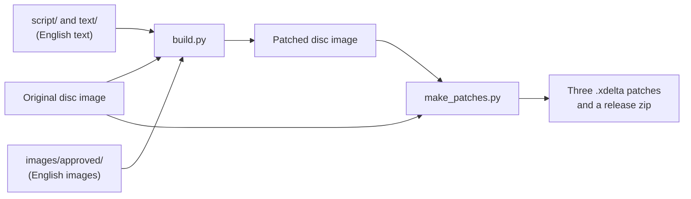

# How the translation works

A tour of the project for anyone curious about what it takes to put English into a
Japanese PlayStation game: players who want to know what the patch does, and ROM hackers
who want to find their way around before reading the detailed documents. It skips the
addresses and byte layouts; [PATCHES.md](PATCHES.md) and [TECHNICAL.md](TECHNICAL.md)
have those.

## What's on the disc

The disc holds four files:

- **`SLPS_020.65`**, the main program. It is always in memory and holds the menu text
  renderer, over a hundred strings, and the routines every mode shares.
- **`FPG.BIN`**, a 42 MB archive of 291 entries. It holds everything else: graphics, fonts,
  wrestler and move data, the story script, and six **code overlays**. An overlay is a
  piece of program that the game loads on top of the previous one when you change mode
  (one for matches, one for the main menus, one for story mode, one for Edit Mode, and so
  on). Most entries are compressed.
- **`FPG.XA`**, the voices, music and the intro movie, which need no changes.
- **`SYSTEM.CNF`**, which tells the PlayStation which program to start.

There is no spare room on the disc: `FPG.BIN` ends exactly where `FPG.XA` begins. Whatever
the translation adds has to fit in the space the Japanese used.

## Why you can't just replace the text

Japanese text in the game is Shift-JIS, two bytes per character, and every part of the
game was built around that:

- **The story text box couldn't draw English.** The story renderer only understood
  two-byte characters, so plain English letters came out blank. The game's font does have
  full-width Latin letters (Ａ, Ｂ, Ｃ…), but each takes a 20-pixel square, which leaves room
  for only about 21 letters on a line.
- **Menus count characters, not pixels.** Each menu window is given a fixed number of
  12-pixel cells, one per Japanese character. English needs two or three times as many
  letters as the Japanese it replaces, so menus cut it off after a few letters. Going past
  a window's budget can also overwrite the next window, or crash the game.
- **Strings are packed tightly.** The menu strings sit back to back inside the program
  code, and the code finds each one by its address. A longer English string can't simply be
  written over a short Japanese one.
- **Records have fixed sizes.** A wrestler's name fields, for example, are 14, 20 and 26
  bytes long, and writing past one overwrites the next field.
- **Some text is artwork.** Mode names, labels and victory captions are pictures, not
  text.

## What the patch changes

### A variable-width font

The heart of the patch is two small pieces of new code, written in MIPS assembly and
added to the game: one for the story text box and one for the menu renderer. When the
game reaches an English letter, the new code draws it at its real width (an "i" is much
narrower than an "m") and packs the letters side by side into the same 20- or 12-pixel
tiles the game already uses for Japanese. A line of English then takes about as many tiles
as a line of Japanese did, so it fits the original windows without changing how they are
laid out.

The menu font also got proper widths for the Latin letters, and a few glyphs were redrawn.

### The story script

The Fighting Road story is 522 scenes, each a small program (who appears, what music
plays, which choice leads where) plus a table of messages. The build rewrites each scene's
message table with the English from `script/NNN.txt` and leaves the program alone. The
Japanese used only about half the space set aside for the script, so the longer English
fits comfortably.

### Menu and system strings

For every code module, the build finds each string and every place in the code that
refers to it. If the English fits in the Japanese string's space, it is written in place.
If not, it goes into a new block of strings added to the end of the module, and every
reference is changed to point there. The main program has no free space at all, so its
strings are instead shuffled and packed into the space the Japanese strings used.

### Names, moves and other records

Wrestler names, move names and the edit wrestlers are written into their fixed-size
records, with the build checking every length. Where a field was too short for a real
name, a small change to the game's name-building routine lets the full name come from a
longer field.

### Screens that needed a little more

Some screens had no room to spare and needed their own fixes: wider boxes on the match
setup screen, a reorganised Skill Edit screen whose cells were all used up, button icons
moved to make room for longer labels in Move Edit and the Dojo tutorial, and a slash
instead of the 年月日 kanji in birth dates.

### Images

`images/graphics.csv` lists every picture with Japanese text that the translation
replaces. The English versions are drawn as PNGs ([EDITING.md](EDITING.md)), and the build
converts each to the picture's own colour palette and writes it into the game's
texture data. The arena banners, the title logo and the promotion logos stay in Japanese
as part of the original artwork.

### Putting it back together

Once everything is changed, the build compresses the changed entries again, rebuilds
`FPG.BIN` (the project's compressor packs slightly tighter than the original, which leaves
some room), checks that it is no larger than before, and writes it and the main program
back into a copy of the disc image. CD sectors carry error-correction codes, so those are
recalculated for every changed sector.

### Beyond the text

Two optional patches use the same tools:

- **All Unlocked** changes the routine that runs when you finish the story, so that it
  also grants every Edit Ranking reward and runs whenever save data is created or loaded.
- **Extra parts** adds 13 unused heads and some unused body parts found on the disc to
  Wrestler Make.

The build can also restore the developers' hidden test menu, for testing
([HIDDEN_CONTENT.md](HIDDEN_CONTENT.md)).

## From a translated line to a patch

1. A translator edits a text file: `script/` for the story, `text/` for everything else.
   Each file keeps the Japanese next to the English.
2. `build.py` reads the original disc image, applies every change above, and writes a new
   image. It never changes the original, and the same inputs always give exactly the same
   output.
3. `make_patches.py` builds the three release versions and records the difference between
   each one and the original disc as an `.xdelta` patch. Players apply a patch to their own
   copy of the disc, so the game itself is never shared.

The details are in [BUILDING.md](BUILDING.md).

## How we know it works

- **Checks on the text.** `storylint.py` checks every story message for missing
  English, leftover codes and wrong speaker labels. `storycheck.py` lays out every message
  pixel by pixel the way the patched game will, and can try it with the longest name a
  player can enter. The build repeats the most important checks and stops on errors.
- **The new code runs before it reaches the game.** The project includes a small
  PlayStation CPU simulator. The tests run the real font code in it and compare what it
  draws with what the layout checker predicted.
- **Unit tests** cover the compression, the archive, the code patching and the text
  formats, and confirm that the translation files are complete
  (`python3 -m unittest discover -s tests -t .`).
- **Playing the game.** Everything is checked in the DuckStation emulator in the end.
  [TESTING.md](TESTING.md) tracks what has been played and what hasn't, and that is
  where help is most needed.

## Where to go next

| If you want to… | Read |
|---|---|
| Fix or improve the translation | [TRANSLATION.md](TRANSLATION.md), then [CONTRIBUTING.md](../CONTRIBUTING.md) |
| Build the patch yourself | [BUILDING.md](BUILDING.md) |
| Redraw an image | [EDITING.md](EDITING.md) |
| See exactly what each patch changes | [PATCHES.md](PATCHES.md) |
| Learn the game's file formats | [TECHNICAL.md](TECHNICAL.md) |
| Explore cut content and the debug menu | [HIDDEN_CONTENT.md](HIDDEN_CONTENT.md) |
| Find a tool | [tools/README.md](../tools/README.md) |
