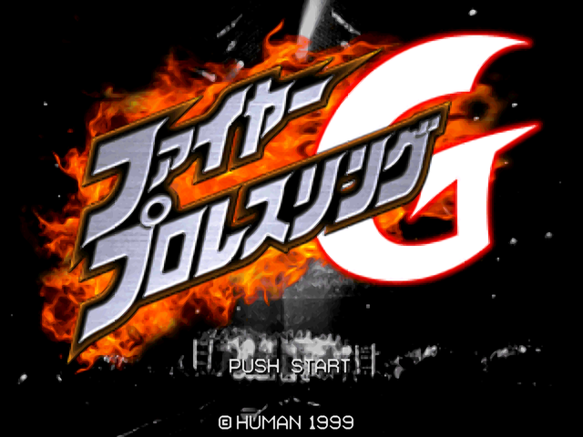
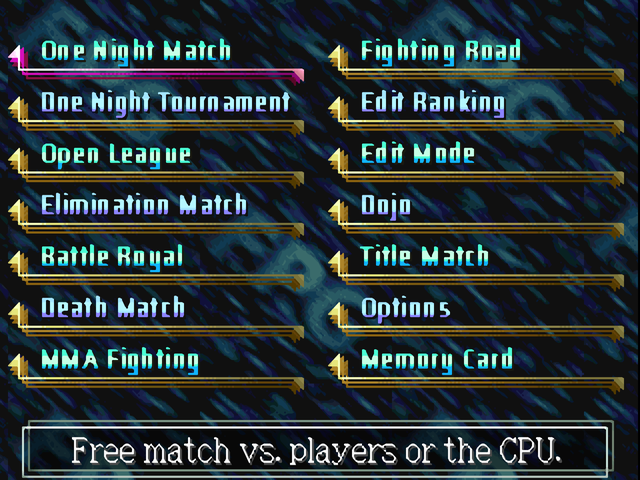
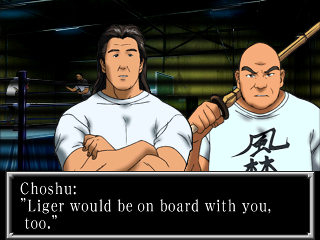
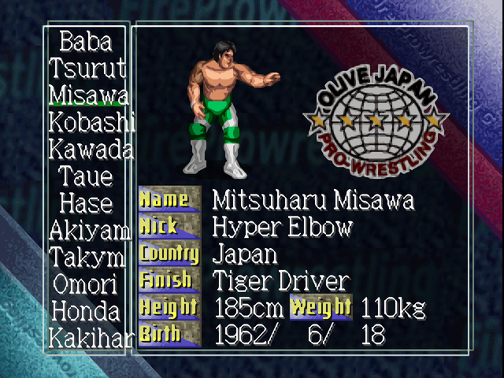
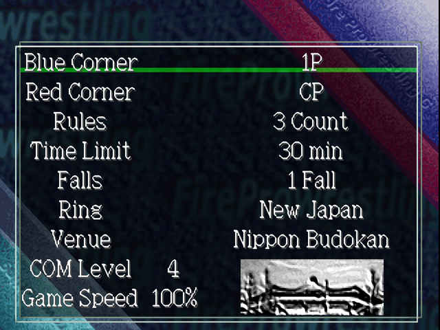
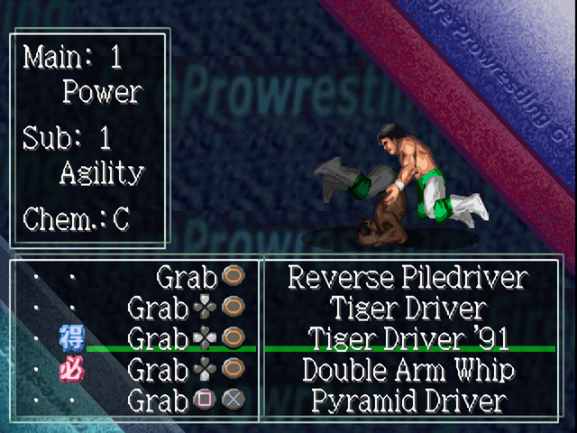

# Screenshots

Fire Pro Wrestling G with the English patch, taken in DuckStation.

## Title screen

The title logo stays in Japanese, like the rest of the game's artwork.

## Mode select

The mode names are redrawn images; the description at the bottom is regular menu text.

## Fighting Road (story mode)

Story text uses the new variable-width font, so English lines fit the original text box.

## Wrestler select

Wrestlers go by their real names. The labels on the left of the profile are redrawn images.

## Match setup

## Move Edit

The button icons were moved so the longer English labels fit beside them.
